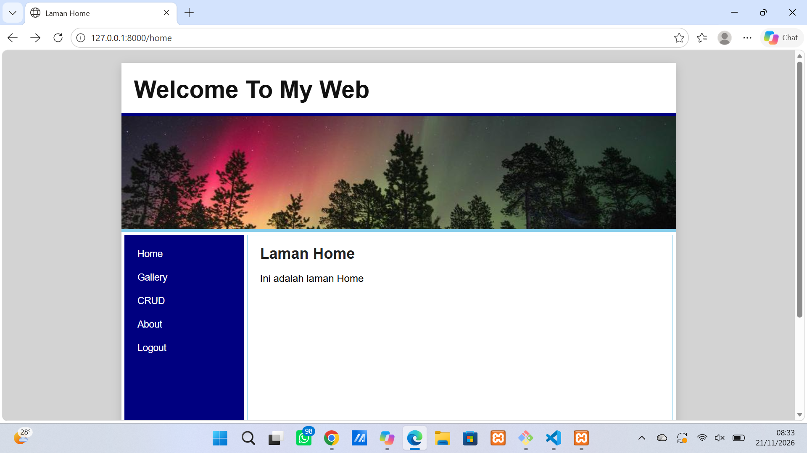
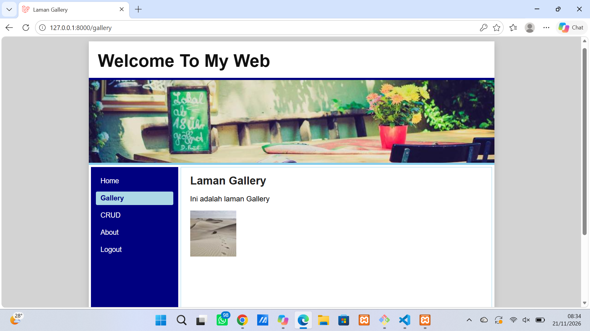
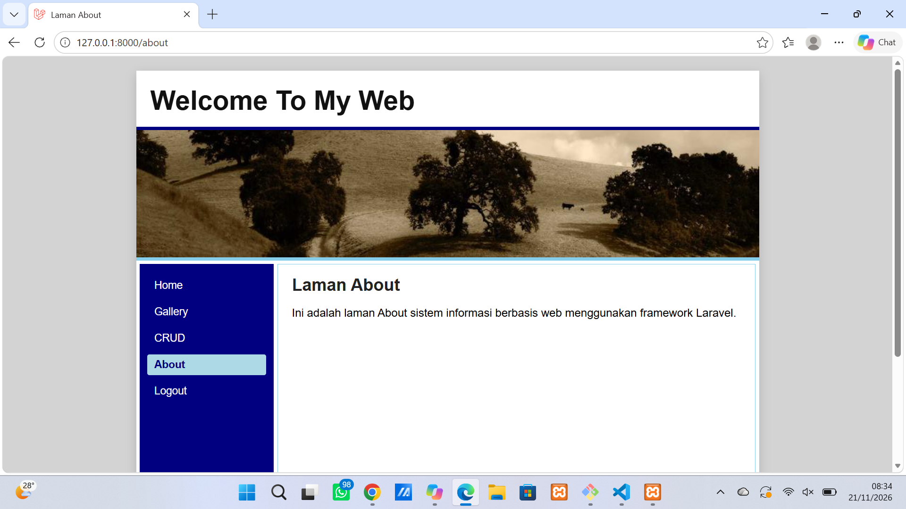
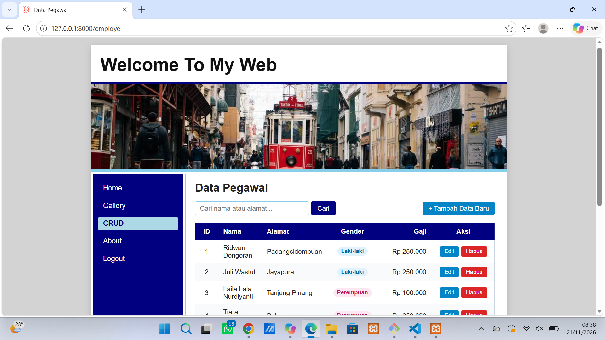
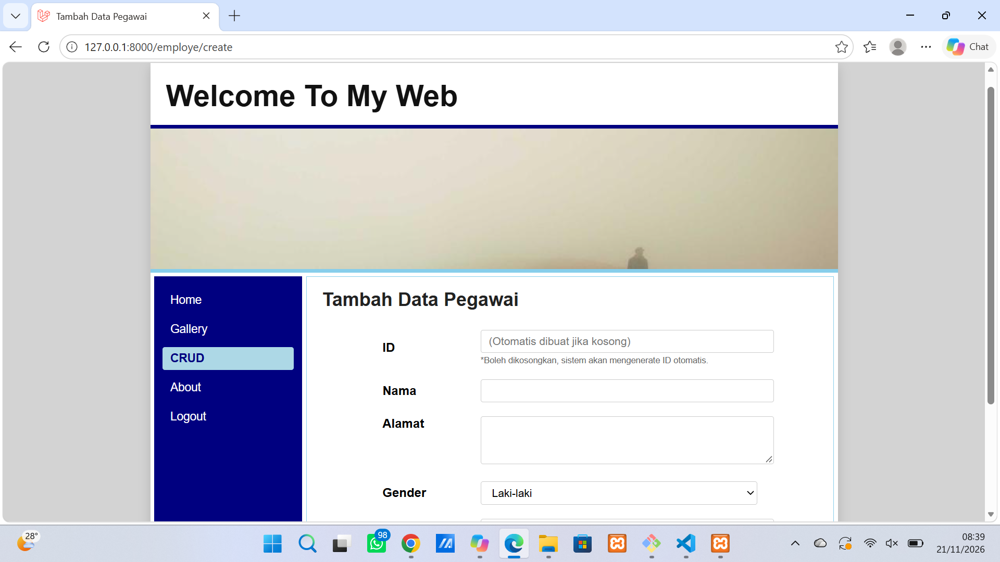
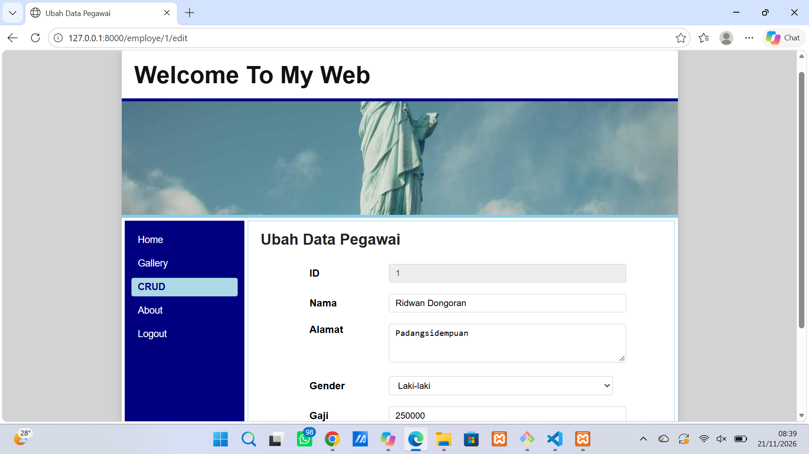
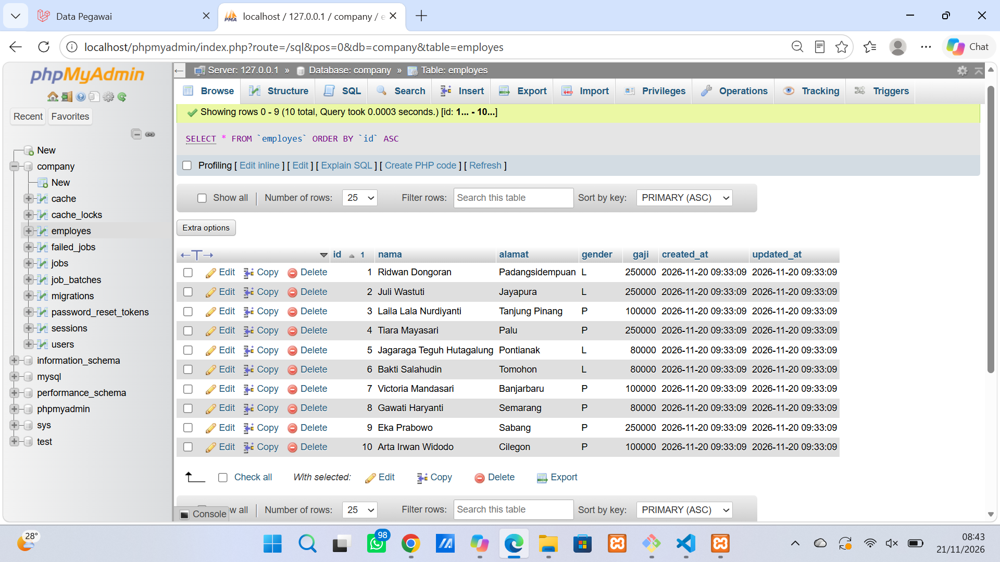
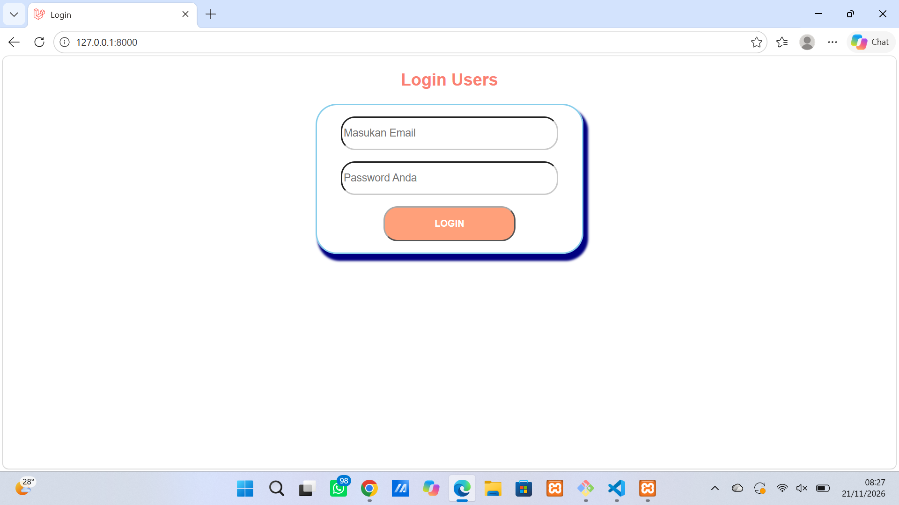
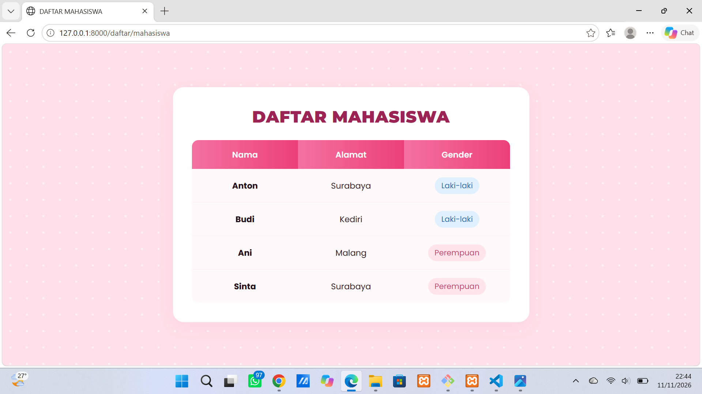
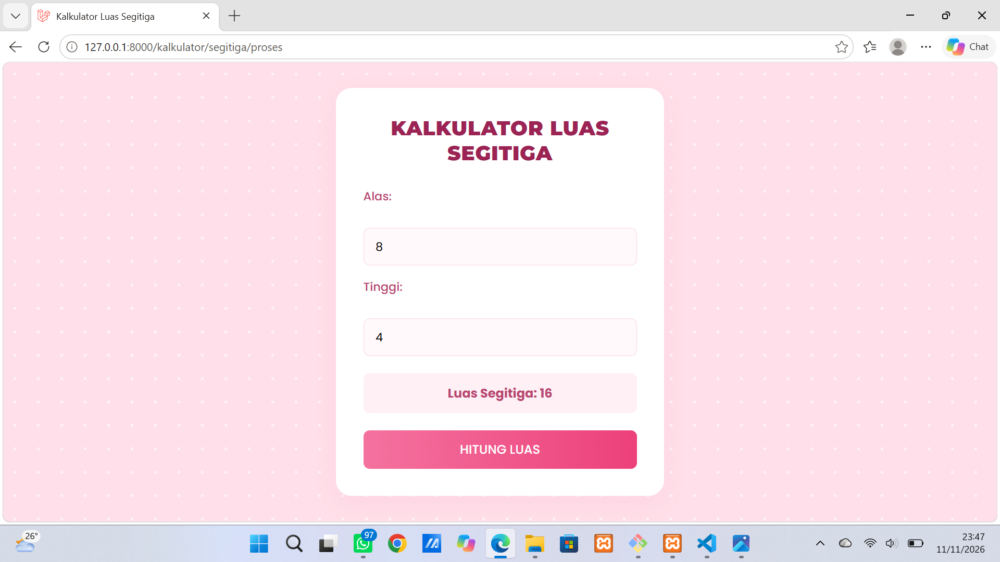

# Dokumentasi Praktikum Pemrograman Web – Framework Laravel

## 👤 Identitas Mahasiswa

| Informasi | Keterangan |
|---|---|
| **Nama** | Anggi Mahardika Dwi Utami |
| **NPM** | 2513020070 |
| **Kelas** | 2-A Sistem Informasi |
| **Mata Kuliah** | Pemrograman Web |
| **Modul Acuan** | Modul Praktikum Framework Laravel (Rudy Eko Prasetya, S.Kom) |
| **Repository GitHub** | [anggimahardika155-cell/belajar-laravel-2a](https://github.com/anggimahardika155-cell/belajar-laravel-2a) |

---

## 📖 Deskripsi Umum Project

Project ini merupakan implementasi aplikasi web berbasis framework **Laravel** yang dikembangkan secara bertahap mengikuti modul praktikum pemrograman web dinamis. 

Dokumentasi bagian atas ini mencakup empat bab lanjutan utama: **Sistem Templating**, **CRUD Data Pegawai**, **Migration, Seeder & Factory**, serta **Autentikasi Pengguna**. *(Dokumentasi tugas awal: Daftar Mahasiswa & Kalkulator Segitiga tetap tersimpan utuh di bagian bawah halaman ini).*

---

## 🛠️ Lingkungan dan Teknologi yang Digunakan

| Komponen | Spesifikasi / Keterangan |
|---|---|
| **Framework** | Laravel Framework 13.40.0 |
| **Bahasa Pemrograman** | PHP 8.5.12 (CLI) / Kompatibel PHP ^8.2 |
| **Database Management** | MySQL / MariaDB (XAMPP Server) |
| **Database Name** | `company` |
| **Template Engine** | Laravel Blade Engine |
| **Library Dummy Data** | Faker PHP (`id_ID` locale) |
| **Version Control** | Git & GitHub |

---

## 📑 Rincian Pengerjaan Modul Praktikum

Berikut adalah rincian lengkap 4 modul praktikum lanjutan yang telah diimplementasikan:

---

### 1️⃣ Bab: Sistem Templating (Modul Hal. 12–18)

#### A. Konsep & Tujuan
Sistem templating bertujuan memecah halaman web yang kompleks menjadi komponen-komponen modular (*reusable components*) sehingga kode program lebih rapi, mudah dirawat, dan memisahkan logika tampilan secara terstruktur.

#### B. Implementasi Arsitektur Layout
Layout dibagi menjadi tiga bagian utama sesuai modul praktikum:
1. **Master Layout (`resources/views/dashboard.blade.php`)**: Berfungsi sebagai kerangka utama (*master template*) yang memuat CSS `templating.css`, menyertakan header dan sidebar, serta mendefinisikan wadah dinamis `@yield('content')`.
2. **Header (`resources/views/template/header.blade.php`)**: Menampilkan judul utama situs `"Welcome To My Web"` dan elemen spanduk visual (`.banner`).
3. **Sidebar (`resources/views/template/sidebar.blade.php`)**: Menu navigasi samping berwarna *Navy* dengan tautan ke halaman `Home`, `Gallery`, `CRUD (Pegawai)`, `About`, dan `Logout`.
4. **Halaman Anak (*Child Views*)**:
   - `resources/views/home.blade.php`: Memanggil `@extends('dashboard')` dan mengisi section content untuk beranda.
   - `resources/views/gallery.blade.php`: Menampilkan galeri gambar menggunakan template utama.
   - `resources/views/about.blade.php`: Menampilkan profil informasi aplikasi web dalam bingkai template.

#### C. Controller & Routing Terkait
* **Controller:** `app/Http/Controllers/DashboardController.php` (method: `home()`, `gallery()`, `about()`).
* **Styling:** `public/css/templating.css` mengatur tata letak flexbox, kontainer tengah (`width: 880px`), garis batas spanduk `navy` dan `skyblue`, serta warna menu navigasi yang responsif terhadap aksi kursor.

---

### 2️⃣ Bab: Membuat CRUD Data Pegawai (Modul Hal. 19–27)

#### A. Konsep & Tujuan
CRUD (*Create, Read, Update, Delete*) pada data pegawai (`employes`) dibangun menggunakan **Eloquent ORM**, sehingga manipulasi data database dapat dilakukan langsung menggunakan object PHP tanpa menuliskan query SQL manual (*Active Record pattern*).

#### B. Struktur Fitur & Alur Operasi
1. **Tampil Data (Read):**
   - Mengambil data seluruh pegawai via `Employe::all()` atau memfilter data pencarian via query `like` pada nama dan alamat.
   - Ditampilkan pada view `resources/views/tampil_data.blade.php` dalam bentuk tabel berheader Navy, dilengkapi *badge* penanda gender dan format rupiah untuk nominal gaji.
2. **Tambah Data (Create & Store):**
   - Halaman form input: `resources/views/tambah_data.blade.php`.
   - Method `store()` pada `EmployeController`: Memvalidasi input wajib, memvalidasi keunikan ID (jika diisi), atau mengizinkan ID otomatis melalui fitur Auto Increment database.
3. **Ubah Data (Edit & Update):**
   - Menampilkan data lama pada form edit: `resources/views/edit_data.blade.php`.
   - Menggunakan *HTTP Method Spoofing* `@method('PUT')` pada form HTML untuk mengirimkan pembaruan data ke route `PUT /employe/{id}`.
4. **Hapus Data (Delete / Destroy):**
   - Menggunakan form dengan `@method('DELETE')` dan konfirmasi javascript `confirm()` untuk mencegah penghapusan data secara tidak sengaja.
   - Menghapus record melalui `Employe::destroy($id)` dan memberikan pesan notifikasi sukses (*flash session message*).

#### C. File Utama CRUD Pegawai
* **Model:** `app/Models/Employe.php` (mendefinisikan `$table = 'employes'`, primary key, dan kolom `$fillable`).
* **Controller:** `app/Http/Controllers/EmployeController.php` (method: `index()`, `create()`, `store()`, `edit()`, `update()`, `destroy()`).
* **Views:** `tampil_data.blade.php`, `tambah_data.blade.php`, `edit_data.blade.php`.

---

### 3️⃣ Bab: Tentang Migration, Seeder, dan Factory (Modul Hal. 27–33)

#### A. Konsep & Tujuan
* **Migration:** Sistem kontrol versi (*version control*) untuk database yang memungkinkan pendefinisian skema tabel menggunakan kode PHP terstruktur.
* **Seeder & Factory:** Mengisi tabel database dengan data contoh (*dummy/testing data*) secara otomatis menggunakan pustaka Faker tanpa perlu input manual di phpMyAdmin.

#### B. File Migrasi Database
1. **Migrasi Tabel `users` (`database/migrations/0001_01_01_000000_create_users_table.php`):**
   Disesuaikan dengan modul halaman 29:
   - `id`: Auto increment primary key
   - `nama`: `string('nama', 100)`
   - `email`: `string('email', 100)->unique()`
   - `password`: `string('password', 100)`
   - `foto`: `tinyText('foto')->nullable()`
   - `role`: `enum('role', ['admin', 'user'])`
   - `timestamps`: `created_at` & `updated_at`
   - *(Tetap mempertahankan tabel `sessions` dan `password_reset_tokens` agar sistem sesi Laravel 11 berjalan normal)*.

2. **Migrasi Tabel `employes` (`database/migrations/2026_11_20_000000_create_employes_table.php`):**
   Disesuaikan dengan modul halaman 19 & 30:
   - `id`: Auto increment primary key (`$table->id()`)
   - `nama`: `string('nama', 100)->nullable()`
   - `alamat`: `text('alamat')->nullable()`
   - `gender`: `enum('gender', ['L', 'P'])->nullable()`
   - `gaji`: `integer('gaji')->nullable()`
   - `timestamps`: `created_at` & `updated_at`

#### C. File Seeder & Factory
1. **UserSeeder (`database/seeders/UserSeeder.php`):**
   Menyisipkan 1 akun admin utama ke tabel `users` dengan enkripsi password `Hash::make('123456')`.
2. **EmployeSeeder (`database/seeders/EmployeSeeder.php`):**
   Menggunakan generator `Faker\Factory::create('id_ID')` untuk menghasilkan 10 data pegawai dummy acak dengan nama Indonesia, kota, gender, rentang gaji, dan timestamp.
3. **DatabaseSeeder (`database/seeders/DatabaseSeeder.php`):**
   Menjalankan eksekusi kedua seeder di atas secara berurutan menggunakan method `$this->call(...)`.

#### D. Perintah Eksekusi CLI
```bash
# Menjalankan seluruh migrasi dari awal dan langsung mengisi data dummy seeder
php artisan migrate:fresh --seed
```

---

### 4️⃣ Bab: Membuat Autentifikasi (Modul Hal. 33–38)

#### A. Konsep & Tujuan
Autentikasi digunakan untuk mengamankan halaman web agar hanya pengguna terdaftar yang dapat melihat dan memanipulasi data aplikasi. Perlindungan diterapkan menggunakan mekanisme Session HTTP dan Middleware.

#### B. Alur Logika Autentikasi
1. Pengguna membuka URL dasar aplikasi (`http://localhost:8000/`), route langsung mengarahkan ke tampilan `login.blade.php`.
2. Pengguna mengisi email dan password, lalu form dikirim via method `POST /login` ke `AuthController@cek`.
3. Controller mencari kecocokan email pada model `User`. Jika ditemukan, `Hash::check()` memvalidasi password:
   - **Jika Valid:** Menyimpan sesi `session(['logged_in' => true, 'email' => $request->email])` dan mengarahkan ke `/dashboard`.
   - **Jika Gagal:** Mengembalikan pengguna ke halaman login `/`.
4. Halaman Dashboard, Gallery, About, dan seluruh CRUD Employe dibungkus dalam grup Middleware `islogin`. Jika pengguna yang belum login memaksa mengakses URL tersebut, sistem otomatis memblokir dan mengarahkan kembali ke `/`.
5. Pengguna dapat keluar dengan mengklik tautan **Logout** di sidebar, yang akan mengeksekusi `$request->session()->flush()` dan mengarahkan kembali ke halaman login.

#### C. File Terkait Autentikasi
* **View Login:** `resources/views/login.blade.php` (form login dengan directive `@csrf` dan styling box dari modul).
* **Controller:** `app/Http/Controllers/AuthController.php` (fungsi `cek()` untuk validasi login dan `logout()` untuk menghapus sesi).
* **Middleware:** `app/Http/Middleware/IsLogin.php` (pemeriksaan status sesi `session('logged_in')`).
* **Registrasi Middleware:** `bootstrap/app.php` mendaftarkan alias route middleware `'islogin'`.
* **Sidebar:** `resources/views/template/sidebar.blade.php` memuat link menu `/logout`.

---

## 🗂️ Struktur Folder & File Terkini

```text
web-app/
├── app/
│   ├── Http/
│   │   ├── Controllers/
│   │   │   ├── AuthController.php          <-- Controller Login & Logout
│   │   │   ├── DashboardController.php     <-- Controller Templating
│   │   │   ├── EmployeController.php       <-- Controller CRUD Data Pegawai
│   │   │   ├── KalkulatorController.php
│   │   │   ├── KalkulatorSegitigaController.php
│   │   │   ├── MahasiswaController.php
│   │   │   └── Web.php
│   │   └── Middleware/
│   │       └── IsLogin.php                 <-- Middleware Proteksi Akses
│   └── Models/
│       ├── Employe.php                     <-- Model Eloquent Tabel Employes
│       └── User.php                        <-- Model Eloquent Tabel Users
├── bootstrap/
│   └── app.php                             <-- Registrasi Alias Middleware
├── database/
│   ├── migrations/
│   │   ├── 0001_01_01_000000_create_users_table.php     <-- Migrasi Tabel Users
│   │   └── 2026_11_20_000000_create_employes_table.php  <-- Migrasi Tabel Employes
│   └── seeders/
│       ├── DatabaseSeeder.php              <-- Seeder Induk
│       ├── EmployeSeeder.php               <-- Faker Seeder Pegawai (10 data)
│       └── UserSeeder.php                  <-- Seeder Akun Admin
├── public/
│   └── css/
│       ├── style.css                       <-- Styling Praktikum Awal
│       └── templating.css                  <-- Styling Sistem Templating & CRUD
├── resources/
│   └── views/
│       ├── template/
│       │   ├── header.blade.php            <-- Komponen Header & Banner
│       │   └── sidebar.blade.php           <-- Komponen Sidebar Navigasi
│       ├── about.blade.php                 <-- View Halaman About
│       ├── dashboard.blade.php             <-- Master Template Layout
│       ├── edit_data.blade.php             <-- View Form Ubah Data Pegawai
│       ├── gallery.blade.php               <-- View Halaman Gallery
│       ├── home.blade.php                  <-- View Halaman Home
│       ├── login.blade.php                 <-- View Form Login Autentikasi
│       ├── tambah_data.blade.php           <-- View Form Tambah Data Pegawai
│       └── tampil_data.blade.php           <-- View Daftar Data Pegawai
└── routes/
    └── web.php                             <-- Pemetaan Seluruh Route Web
```

---

## 🔗 Tabel Pemetaan Routing (`routes/web.php`)

| Method | Endpoint URI | Controller / Action | Middleware | Fungsi / Keterangan |
|:---:|---|---|:---:|---|
| **GET** | `/` | Closure (`view('login')`) | - | Menampilkan halaman login utama |
| **POST** | `/login` | `AuthController@cek` | - | Memproses validasi akun pengguna |
| **GET** | `/dashboard` | `DashboardController@home` | `islogin` | Beranda dashboard (setelah login) |
| **GET** | `/gallery` | `DashboardController@gallery` | `islogin` | Halaman galeri foto |
| **GET** | `/about` | `DashboardController@about` | `islogin` | Halaman informasi tentang web |
| **GET** | `/employe` | `EmployeController@index` | `islogin` | Menampilkan tabel data pegawai & form pencarian |
| **GET** | `/employe/create` | `EmployeController@create` | `islogin` | Menampilkan form tambah pegawai baru |
| **POST** | `/employe` & `/employe/store` | `EmployeController@store` | `islogin` | Menyimpan data pegawai baru ke database |
| **GET** | `/employe/{id}/edit` | `EmployeController@edit` | `islogin` | Menampilkan form edit data pegawai |
| **PUT** | `/employe/{id}` | `EmployeController@update` | `islogin` | Memperbarui data pegawai di database |
| **DELETE** | `/employe/{id}` | `EmployeController@destroy` | `islogin` | Menghapus data pegawai dari database |
| **GET** | `/logout` | `AuthController@logout` | `islogin` | Menghapus sesi login dan kembali ke form login |

---

## 🚀 Panduan Menjalankan Aplikasi di Lingkungan Lokal

1. **Pastikan Web Server & Database Aktif:**
   * Buka control panel **XAMPP**.
   * Jalankan modul **Apache** dan **MySQL**.
   * Buka phpMyAdmin (`http://localhost/phpmyadmin`) dan pastikan database bernama `company` sudah tersedia.

2. **Buka Terminal / Git Bash:**
   Arahkan ke folder project `web-app`:
   ```bash
   cd web-app
   ```

3. **Reset Database & Jalankan Seeder Otomatis:**
   ```bash
   php artisan migrate:fresh --seed
   ```
   *Perintah ini akan membuat ulang tabel users dan employes, serta mengisinya dengan data awal.*

4. **Jalankan Development Server Laravel:**
   ```bash
   php artisan serve
   ```
   *Server lokal aktif di alamat `http://127.0.0.1:8000`.*

5. **Akses Aplikasi di Browser:**
   * Buka alamat: **`http://localhost:8000`**
   * **Kredensial Login Akun Admin (dari Seeder):**
     * **Email:** `rudyekoprasetya@mail.com`
     * **Password:** `123456`
   * Klik tombol **LOGIN** untuk masuk ke sistem dashboard dan mengelola data pegawai.

   ## 📸 Dokumentasi Tugas Terbaru

| Modul | Halaman / Tampilan | Dokumentasi |
|---|---|---|
| 🏗️ Sistem Templating | Dashboard |  |
| 🏗️ Sistem Templating | Gallery |  |
| 🏗️ Sistem Templating | About |  |
| 📝 CRUD Data Pegawai | Daftar Pegawai |  |
| 📝 CRUD Data Pegawai | Form Tambah Pegawai |  |
| 📝 CRUD Data Pegawai | Form Edit Pegawai |  |
| 🗄️ Migration dan Seeder | Tabel `migrations` di phpMyAdmin |  |
| 🔐 Autentikasi | Halaman Login |  |

## ✅ Kesimpulan

Melalui pengerjaan praktikum ini, saya mempelajari pengembangan aplikasi web menggunakan framework Laravel secara bertahap, mulai dari penggunaan route, controller, dan view Blade hingga pengelolaan data dan autentikasi pengguna. Setiap bagian praktikum membantu saya memahami hubungan antara URL yang diakses pengguna, proses yang dikerjakan oleh controller, serta halaman yang ditampilkan melalui view.

Pada modul **Sistem Templating**, saya mempelajari cara menyusun halaman menggunakan layout utama dan komponen yang dapat digunakan kembali, seperti header dan sidebar. Dengan pendekatan ini, tampilan beberapa halaman dapat dibuat lebih konsisten dan struktur view menjadi lebih teratur.

Pada modul **CRUD Data Pegawai**, saya mempraktikkan proses menampilkan, menambahkan, mengubah, dan menghapus data menggunakan controller, model Eloquent, dan database. Saya juga mempelajari penggunaan form, validasi input, pencarian data, serta notifikasi setelah operasi data dilakukan.

Pada modul **Migration dan Seeder**, saya mempelajari cara mendefinisikan struktur tabel menggunakan migration dan mengisi database dengan data awal menggunakan seeder serta Faker. Dengan demikian, struktur dan data awal aplikasi dapat disiapkan melalui perintah Laravel, tanpa harus memasukkan seluruh data secara manual.

Pada modul **Autentikasi**, saya mempraktikkan proses login dan logout menggunakan data pengguna, pengecekan password, session, serta middleware untuk membatasi akses ke halaman tertentu. Modul ini memperlihatkan bagaimana route yang dilindungi dapat meminta pengguna login sebelum halaman dashboard dan fitur pengelolaan data dapat diakses.

Tugas awal **Daftar Mahasiswa** dan **Kalkulator Luas Segitiga** tetap menjadi bagian dari project dan menunjukkan penerapan dasar route, controller, view, serta pengolahan input form. Secara keseluruhan, project ini menjadi latihan untuk memahami alur kerja dasar Laravel dan menerapkannya pada beberapa fitur web. Dokumentasi screenshot disertakan sebagai bukti tampilan hasil pengerjaan setiap modul.


# Mini Project Laravel – Daftar Mahasiswa dan Kalkulator Luas Segitiga

## 👤 Identitas Mahasiswa

| Informasi | Keterangan |
|---|---|
| Nama | Anggi Mahardika Dwi Utami |
| NPM | 2513020070 |
| Kelas | 2-A Sistem Informasi |
| Mata Kuliah | Pemograman Web |
| GitHub | [anggimahardika155-cell/belajar-laravel-2a](https://github.com/anggimahardika155-cell/belajar-laravel-2a) |

## 📖 Deskripsi Project

Project ini adalah aplikasi web sederhana yang dibuat menggunakan Laravel. Aplikasi memiliki dua halaman utama:

1. **Daftar Mahasiswa** menampilkan beberapa data mahasiswa berupa nama, alamat/kota, dan jenis kelamin.
2. **Kalkulator Luas Segitiga** menyediakan formulir untuk memasukkan alas dan tinggi, lalu menampilkan luas segitiga.

Project ini merupakan latihan praktikum. Data mahasiswa masih disimpan langsung di controller, bukan di database.

## 🎯 Tujuan Project

Project ini dibuat untuk mempelajari dasar-dasar pengembangan aplikasi web dengan Laravel, khususnya:

- Membuat routing untuk menghubungkan URL dengan halaman.
- Menggunakan controller untuk menyiapkan dan mengolah data.
- Menampilkan data menggunakan view Blade.
- Menerima input dari form.
- Melakukan perhitungan sederhana berdasarkan input pengguna.

## 🛠️ Teknologi yang Digunakan

| Teknologi | Versi/Detail | Penggunaan |
|---|---|---|
| Laravel Framework | 13.40.0 (versi terpasang di project) | Framework aplikasi web dan routing. |
| PHP | 8.5.12 pada lingkungan CLI yang diperiksa; `composer.json` mensyaratkan `^8.3` | Bahasa pemrograman yang menjalankan aplikasi Laravel. |
| Blade | Template engine bawaan Laravel; versi tidak dicantumkan terpisah | Menampilkan data dan halaman aplikasi. |
| CSS | Versi tidak ditentukan | Aturan tampilan pada `public/css/style.css`. |
| Google Fonts | Montserrat dan Poppins; versi tidak dicantumkan | Font yang dimuat oleh kedua halaman. |

## ✨ Fitur Project

| Fitur | Penjelasan |
|---|---|
| Daftar mahasiswa | Menampilkan nama, alamat/kota, dan jenis kelamin mahasiswa dalam tabel. Data disiapkan langsung di `MahasiswaController`; data contoh yang tersedia adalah Anton, Budi, Ani, dan Sinta. |
| Input kalkulator | Form menyediakan kolom untuk memasukkan alas dan tinggi segitiga. |
| Perhitungan luas | Setelah form dikirim, aplikasi menghitung luas menggunakan rumus `1/2 × alas × tinggi`. |
| Hasil perhitungan | Luas segitiga ditampilkan kembali pada halaman kalkulator. |
| Validasi input | Validasi input Laravel belum diterapkan. Nilai yang dikirim saat ini langsung digunakan dalam perhitungan. |

## 📌 Contoh Hasil Aplikasi

### Daftar Mahasiswa

Halaman daftar mahasiswa menampilkan data contoh berikut:

| Nama | Alamat | Jenis Kelamin |
|---|---|---|
| Anton | Surabaya | Laki-laki |
| Budi | Kediri | Laki-laki |
| Ani | Malang | Perempuan |
| Sinta | Surabaya | Perempuan |

### Kalkulator Luas Segitiga

Jika pengguna mengisi alas `10` dan tinggi `8`, halaman kalkulator menampilkan hasil:

```text
Alas: 10
Tinggi: 8
Luas Segitiga: 40
```

Nilai tersebut dihitung menggunakan rumus `1/2 × 10 × 8 = 40`.

## 🧮 Rumus Perhitungan

Rumus yang digunakan:

**Luas segitiga = 1/2 × alas × tinggi**

Contoh: jika alas `10` dan tinggi `8`, maka luasnya adalah `1/2 × 10 × 8 = 40`.

## 📁 Struktur Folder Project

Berikut struktur folder dan file yang terkait dengan dua halaman tugas serta screenshot-nya:

```text
app/
└── Http/
    └── Controllers/
        ├── KalkulatorSegitigaController.php
        └── MahasiswaController.php
resources/
└── views/
    ├── kalkulator_segitiga.blade.php
    └── mahasiswa.blade.php
routes/
└── web.php
public/
└── css/
    └── style.css
docs/
└── screenshots/
    ├── mahasiswa.png
    └── kalkulator.png
```

## 🔗 Penjelasan Routing dan Alur Halaman

### 📋 Daftar Mahasiswa

`GET /daftar/mahasiswa` membuka halaman daftar mahasiswa. Route di `routes/web.php` memanggil method `index` pada `MahasiswaController`. Controller menyiapkan data mahasiswa dan mengirimkannya ke view `mahasiswa.blade.php` untuk ditampilkan.

### 📐 Kalkulator Luas Segitiga

- `GET /kalkulator/segitiga` membuka formulir kalkulator melalui `KalkulatorSegitigaController`.
- Form mengirim nilai alas dan tinggi ke `POST /kalkulator/segitiga/proses`.
- Controller membaca kedua nilai, menghitung luas dengan rumus di atas, lalu mengirim nilai input dan hasilnya ke view `kalkulator_segitiga.blade.php`.

## 🚀 Cara Masuk dan Mengakses Aplikasi

Ikuti langkah-langkah berikut untuk menjalankan server dan membuka halaman tugas:

1. **Buka Git Bash.** Buka terminal pada folder kerja project. Jika terminal belum berada di folder Laravel, masuk ke folder project:

   ```bash
   cd web-app
   ```

   Lewati perintah tersebut jika terminal sudah berada di folder `web-app` yang berisi file `artisan`.

2. **Jalankan server development Laravel:**

   ```bash
   php artisan serve
   ```

   Server biasanya tersedia di `http://127.0.0.1:8000`. Biarkan terminal tetap terbuka selama aplikasi digunakan.

3. **Buka aplikasi di browser.** Gunakan alamat dasar `http://localhost:8000` atau `http://127.0.0.1:8000`, lalu buka halaman tugas:
   - Daftar Mahasiswa: <http://localhost:8000/daftar/mahasiswa>
   - Kalkulator Segitiga: <http://localhost:8000/kalkulator/segitiga>

4. **Hentikan server** setelah selesai dengan kembali ke Git Bash dan menekan **Ctrl + C**.

## 🖼️ Dokumentasi Tampilan

Screenshot halaman yang tersedia di project:

| Halaman | Screenshot |
|---|---|
| Daftar Mahasiswa |  |
| Kalkulator Luas Segitiga |  |

## ✅ Kesimpulan

Melalui project ini, konsep dasar Laravel dipraktikkan dengan menghubungkan route, controller, dan view Blade. Halaman daftar mahasiswa menunjukkan cara menyiapkan serta menampilkan data, sedangkan kalkulator menunjukkan cara menerima input form dan mengolahnya menggunakan rumus sederhana.
